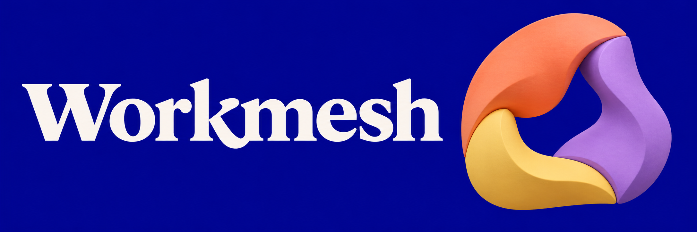
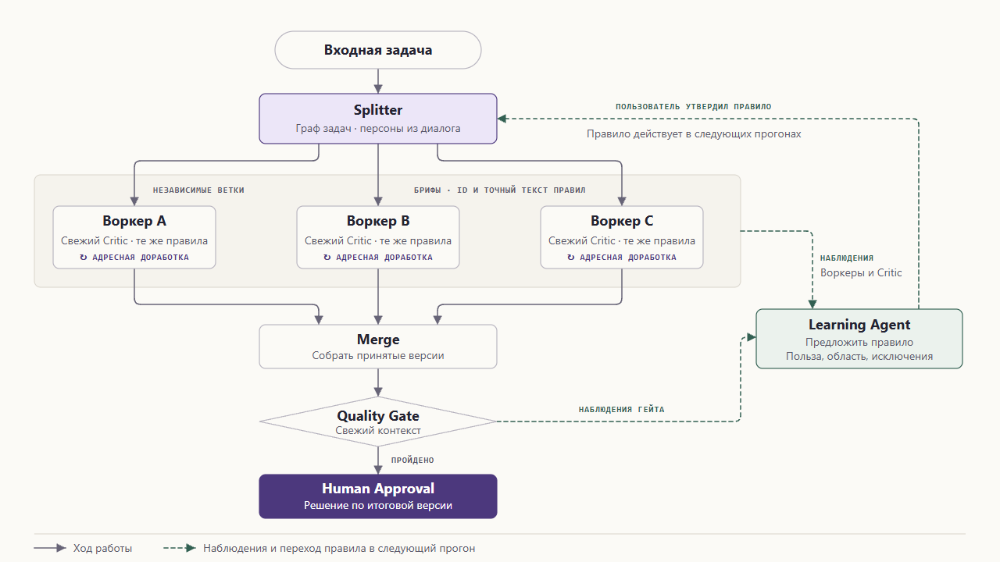

# Workmesh

Workmesh означает «сеть совместной работы». Скилл делит задачу между агентами, отправляет результаты на независимую проверку и собирает итог для вашего утверждения. Если проверка находит ошибку, на доработку возвращается нужная ветка.

## Как подключить

1. Скопируйте папку с [`SKILL.md`](SKILL.md) в каталог скиллов вашего клиента. Например, для Codex подойдёт `~/.agents/skills/workmesh/`.
2. Откройте рабочую папку и отправьте команду `Подключи Workmesh к этому проекту`. В существующем проекте агент прочитает текущие инструкции. В пустой папке предложит создать `AGENTS.md`.
3. Выберите, запускать Workmesh для каждой новой задачи или по необходимости. Агент покажет изменения перед записью. Обязательный режим закрепляется в `AGENTS.md` проекта.

[Инструкция для агента](references/project.md) · [Codex, OpenCode, Hermes, Pi и Claude Code](references/harnesses.md)

## Как идёт работа

[Как Workmesh выбирает между субагентом и отдельной сессией](docs/images/dispatch.png)

[Требования 1.1.0](docs/workmesh-1.1.0.md) · [Трейсы и закрытие прогонов](references/traces.md)
